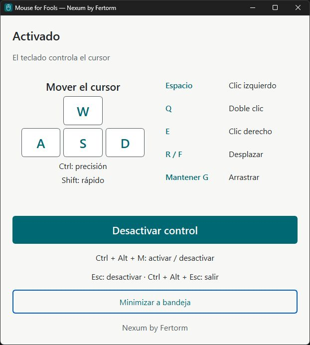

# Mouse for Fools

**Controla el cursor de Windows con el teclado.** Un proyecto de Nexum by Fertorm abierto a contribuciones.



Mouse for Fools parte de una situación cotidiana: el ratón deja de responder y necesitas continuar trabajando. Incluye movimiento, clics, scroll, arrastre y modos de precisión y velocidad, con una ventana y un icono de bandeja.

## Estado

Prototipo experimental funcional para Windows. El autor confirmó manualmente sus funciones en su equipo. Esta publicación comparte las fuentes de la interfaz de fase 4; conserva la versión de paquete 0.3.0 y no representa una migración a C/Win32.

La compatibilidad completa en otros equipos, aplicaciones elevadas y versiones de Windows no está certificada. No se ofrecen beneficios médicos ni una certificación de accesibilidad. Las descargas de binarios aparecerán en [Releases](https://github.com/fertorm/mouse-for-fools-community/releases) cuando haya un paquete revisado; esta publicación inicial contiene código fuente, no promete un ejecutable disponible.

## Ejecutar desde el código fuente

Requisitos: Windows y Python 3.11 o posterior. Los siguientes comandos crean un entorno separado e instalan la interfaz:

```powershell
git clone https://github.com/fertorm/mouse-for-fools-community.git
cd mouse-for-fools-community
py -m venv .venv
.\.venv\Scripts\python.exe -m pip install -e ".[gui]"
.\.venv\Scripts\python.exe -m mouse_for_fools.gui
```

Para comprobar dependencias sin activar los controles globales:

```powershell
.\.venv\Scripts\python.exe -m mouse_for_fools --check
```

## Controles

| Acción | Tecla |
| --- | --- |
| Activar o desactivar | Ctrl + Alt + M |
| Mover | W / A / S / D |
| Precisión | Ctrl + WASD |
| Movimiento rápido | Shift + WASD |
| Clic izquierdo | Espacio |
| Doble clic | Q |
| Clic derecho | E |
| Scroll | R / F |
| Arrastrar | Mantener G y mover |
| Desactivar | Esc |
| Cerrar completamente | Ctrl + Alt + Esc |

La ventana inicia desactivada. Minimizar conserva el modo; cerrar la aplicación detiene el control. Prueba primero en una ventana sin operaciones importantes. No requiere privilegios de administrador y no está diseñado para eludir UAC ni controlar el escritorio seguro.

## Privacidad

La aplicación escucha eventos globales de teclado para reconocer atajos. El código no implementa envío de datos, telemetría ni un historial de lo escrito. Los registros de diagnóstico guardan eventos de servicio y categorías de errores. Consulta [Privacidad](src/mouse_for_fools/legal/PRIVACIDAD.md) para el alcance y la ubicación de los registros. No compartas logs sin revisarlos.

## Desarrollo y contribuciones

Consulta [CONTRIBUTING.md](CONTRIBUTING.md). Se agradecen reportes reproducibles, pruebas en otros equipos, mejoras de navegación por teclado y propuestas de configuración.

```powershell
.\.venv\Scripts\python.exe -m pip install -e ".[dev]"
.\.venv\Scripts\python.exe -m pytest
.\.venv\Scripts\python.exe -m black --check src tests
.\.venv\Scripts\python.exe -m ruff check src tests
.\.venv\Scripts\python.exe -m mypy src
```

## Construir el portable

El script de build actual fija Python 3.14 y las dependencias en `packaging/requirements-build.txt`:

```powershell
./packaging/build-portable.ps1
```

Ejecuta el script desde una sesión configurada para scripts de confianza. Conserva toda la carpeta `_internal` junto al ejecutable. Antes de publicar un binario revisa sus componentes y avisos; la licencia MIT del código propio no reemplaza las licencias de sus dependencias.

## Licencia

Código propio bajo [MIT](LICENSE), copyright 2026 Luis Fernando Torrico Moscoso. Los componentes externos conservan sus licencias: consulta [avisos](packaging/THIRD-PARTY-NOTICES.md) y [licencias](src/mouse_for_fools/legal/LICENCIAS.md). La licencia no implica respaldo de los proveedores ni derechos sobre sus marcas.

